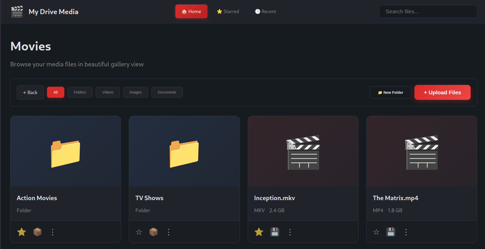
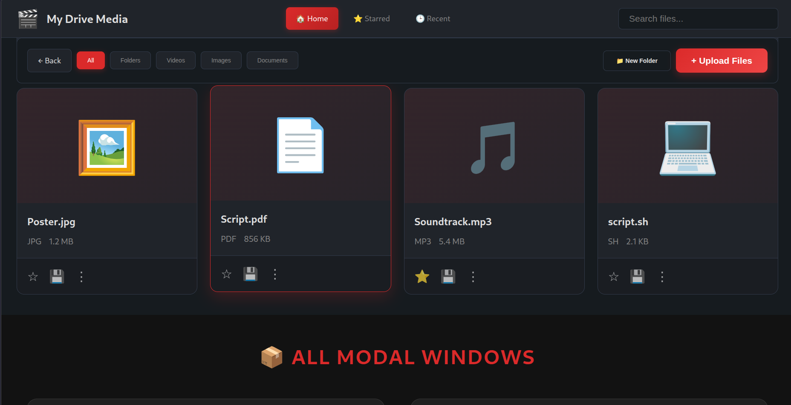
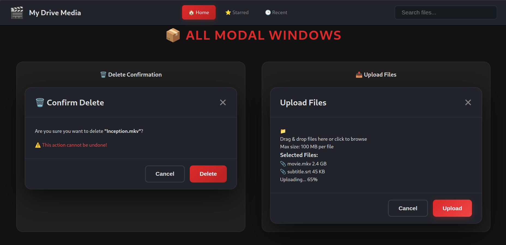
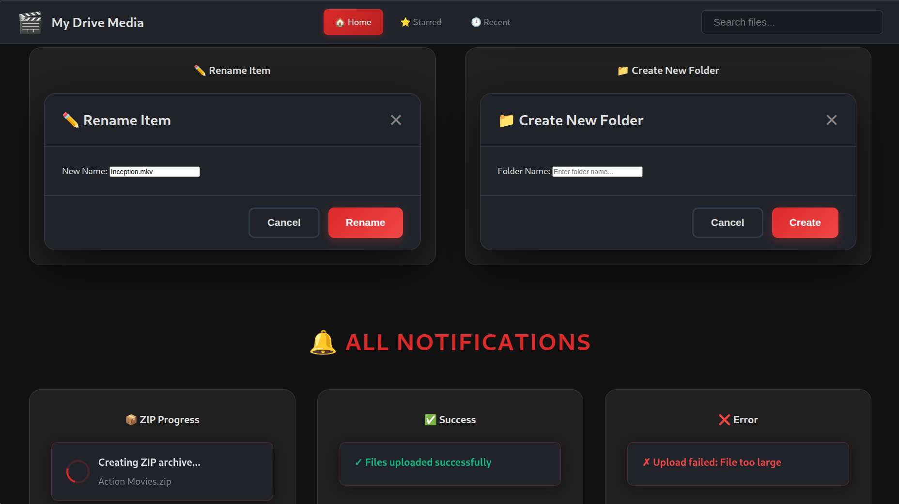
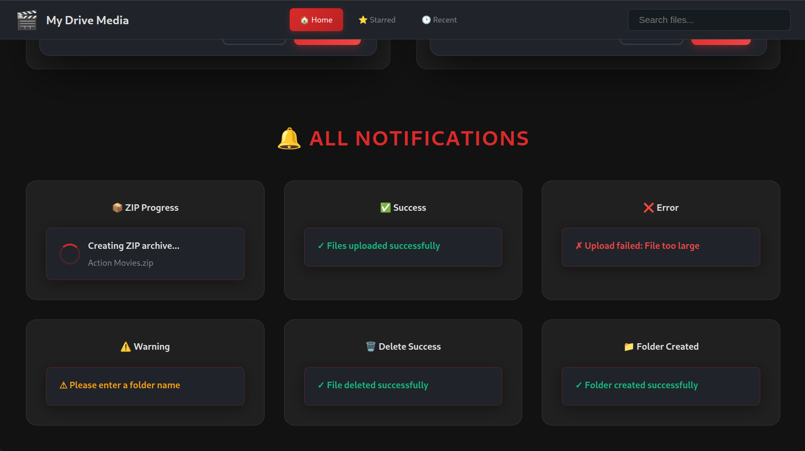

# 🎬 Termux Media Server & Personal Cloud Drive

A lightweight, feature-rich media server and personal cloud storage solution that runs natively in **Termux on Android**. Stream videos, manage files, and access your personal drive from any browser on your local network.

> **No proot, no Docker, no systemd** — pure Python + FFmpeg running directly in Termux.



---

## ✨ Features Overview

### 🎥 Media Streaming
- **Universal Video Support** - Stream any video format (MKV, MP4, AVI, etc.)
- **Automatic Transcoding** - H.264/AAC HLS conversion via FFmpeg
- **Smart Caching** - Reuse transcoded videos, auto-invalidate on file changes
- **Multiple Audio Tracks** - Select from available audio streams
- **Subtitle Support** - Enable and switch between subtitle tracks
- **Non-blocking Playback** - Page loads instantly, stream starts ASAP

### 📁 File Management
- **Upload Files** - Drag & drop multiple files, support for all file types (500MB limit)
- **Download Files** - Direct download from card footer or 3-dot menu
- **Download Folders as ZIP** - Download entire folders as compressed archives (GitHub-style)
- **Delete Files & Folders** - Custom confirmation modal with visual feedback
- **Rename Files & Folders** - Clean rename interface with validation
- **Create Folders** - Easy folder creation anywhere in the hierarchy
- **Star Files & Folders** - Mark favorites for quick access
- **Smart Navigation** - Browse nested folder structures with breadcrumbs
- **Recent Files** - Automatically tracks and displays recently viewed videos

### 👁️ File Preview System
- **Images** - JPG, PNG, GIF, WebP, SVG, BMP, ICO
- **Text Files** - Syntax-highlighted preview for TXT, MD, JSON, XML, CSV, code files
- **PDFs** - Embedded PDF viewer with browser-native controls
- **Audio** - Built-in player for MP3, WAV, OGG, M4A, FLAC
- **Videos** - Automatic redirect to video player with transcoding

### 🎨 Modern Interface
- **Gallery View** - Beautiful card-based layout with hover effects
- **Smart Filters** - Quick filter by All, Folders, Videos, Images, Documents
- **Quick Actions** - Star, download, and manage files from card footer
- **Dark Red Theme** - Comfortable viewing with elegant red accents
- **3-Dot Menus** - Clean context menus with smart positioning (⋮)
- **Custom Modals** - Beautiful modals for rename, delete, folder creation
- **Progress Notifications** - Bottom-right notifications for ZIP downloads and actions
- **Responsive Design** - Works on desktop, tablet, and mobile
- **File Type Icons** - Visual identification (🎬 videos, 📄 documents, 🖼️ images, 🎵 audio)
- **File Size Display** - Human-readable formats (KB, MB, GB)
- **Smooth Animations** - Intuitive visual feedback and transitions
- **Sticky Navigation** - Top nav and filter toolbar stay accessible while scrolling
- **Active Page Highlighting** - Current section highlighted in navigation

### 🔒 Security
- **Path Traversal Protection** - Prevents directory escape attacks
- **Password Protection** - Optional passwords for upload/delete operations
- **Timing Attack Prevention** - Secure password comparison using HMAC
- **Safe Filename Handling** - Automatic sanitization of uploaded filenames
- **File Size Validation** - Configurable upload limits
- **Root Directory Protection** - Cannot delete the media root

---

## 📸 Screenshots

### Gallery View
Beautiful card-based layout with bluish folders and reddish file backgrounds.


### File Cards & Actions
Star, download, and manage files with 3-dot menus and quick actions.



### Modal Windows
Clean modal dialogs for upload, rename, delete, and folder creation.



### Delete Confirmation
Custom delete confirmation with warning message.



### All UI Components
Complete showcase of modals and notifications.



> **Note:** Video player UI screenshots require an actual video stream and will be added when the server is running with media files.

---

## 🎨 UI Demo

Want to see the interface without running the full server? Check out the standalone demo:

```bash
cd demo
open index.html  # or use: python3 -m http.server 8000
```

The demo includes:
- ✅ Complete UI showcase (navigation, gallery, filters)
- ✅ Interactive elements (star toggle, filters, navigation)
- ✅ Sample content (folders, videos, images, documents)
- ✅ Modal dialogs and notifications
- ✅ No backend required - pure HTML/CSS/JS
- ❌ Video player not included (requires backend + HLS.js)

Perfect for screenshots, design demos, or testing the UI on different devices!

**Note:** The video player with HLS streaming can only be seen by running the full server and playing an actual video file.

---

## 🚀 Quick Start

### Prerequisites

1. **Grant Storage Access**
```bash
termux-setup-storage
# Tap "Allow" when prompted
```

2. **Update Packages**
```bash
pkg update && pkg upgrade -y
```

3. **Install Dependencies**
```bash
pkg install python ffmpeg -y
```

### Installation

1. **Get the Project**
```bash
cd ~
git clone <your-repo-url> media-server
# Or extract from ZIP if you have it
```

2. **Install Python Dependencies**
```bash
cd ~/media-server
pip install -r requirements.txt
```

3. **Download HLS.js** (Required for video playback)
```bash
curl -L "https://cdn.jsdelivr.net/npm/hls.js@latest/dist/hls.min.js" \
  -o ~/media-server/static/js/hls.min.js
```

4. **Verify Installation**
```bash
ffmpeg -version
ffprobe -version
ls -lh ~/media-server/static/js/hls.min.js
```

5. **Start the Server**
```bash
cd ~/media-server
python app.py
```

You'll see output like:
```
============================================
         TERMUX MEDIA SERVER
============================================

  Media root:  /storage/downloads/Movies
               ✓ Accessible

  FFmpeg:      ✓ Found
  FFprobe:     ✓ Found
  HLS.js:      ✓ Found

  Cache:       ✓ /tmp/media-server/cache

  Server:      http://192.168.1.42:8080
  Max jobs:    1

  Open the URL above in your browser.
  Press CTRL+C to stop the server.

============================================
```

Open the URL in your browser and start using your media server!

---

## 📖 Usage Guide

### Browse & Navigate
1. Open `http://<your-phone-ip>:8080/browse/` in any browser
2. Browse files in the beautiful gallery view with large preview cards
3. Use **filter buttons** to quickly show only Folders, Videos, Images, or Documents
4. Click folders to navigate deeper
5. Click the "← Back" button to go up one level
6. Click any file card to preview or play

### Navigation Tabs
- **🏠 Home** - Browse all your files and folders
- **⭐ Starred** - Quick access to your favorite files and folders
- **🕒 Recent** - View recently watched videos (auto-tracked)

### Star Files & Folders
1. Click the **☆** icon on any file or folder card
2. Icon turns to **⭐** when starred
3. Access all starred items from the **⭐ Starred** tab
4. Click again to unstar

### Filter Files
1. Use the toolbar buttons to filter your view:
   - **All** - Show everything
   - **Folders** - Show only folders
   - **Videos** - Filter by video files (.mp4, .mkv, .avi, etc.)
   - **Images** - Filter by images (.jpg, .png, .gif, etc.)
   - **Documents** - Filter by documents, text files, scripts (.pdf, .txt, .sh, .py, .md, etc.)

### Download Files
- **Quick Download**: Click the **💾** icon in the card footer
- **Menu Download**: Click 3-dot menu (⋮) → **Download**
- **Preview Download**: Preview the file → Click **💾 Download** button in the modal

### Download Folders as ZIP
- **Quick ZIP**: Click the **📦** icon on folder cards
- **Progress**: Watch the bottom-right notification while ZIP is being created
- Downloads entire folder structure as a compressed `.zip` file
- Perfect for backing up or sharing entire directories

### Upload Files
1. Click **"📤 Upload Files"** button
2. Drag and drop files into the upload zone, or click to browse
3. Click **"Upload"** to start
4. Wait for the progress bar to complete

### Create Folders
1. Navigate to the desired parent directory
2. Click **"📁 Create Folder"** button
3. Enter a folder name (letters, numbers, spaces, `-`, `_`, `.`)
4. Press **Enter** or click **"Create"**

### Preview Files
1. Click on any file name
2. **Images** - Full-screen preview with download option
3. **Text/Code** - Syntax-highlighted view (50KB limit)
4. **PDFs** - Embedded viewer with native browser controls
5. **Audio** - Built-in player with playback controls
6. **Videos** - Redirects to video player with transcoding

### Rename Files/Folders
1. Click 3-dot menu (⋮) → **✏️ Rename**
2. Enter new name in the modal dialog
3. Press **Enter** or click **"Rename"**
4. Filename without extension is auto-selected for convenience

### Delete Files/Folders
1. Click 3-dot menu (⋮) → **🗑️ Delete**
2. Confirm deletion in the custom modal dialog
3. Warning message shows that action cannot be undone
4. Success notification appears in bottom-right corner
5. Page refreshes automatically to show updated list
6. Folders are deleted recursively (all contents removed)

### Play Videos
1. Click on any video file card
2. Video is automatically added to **🕒 Recent** list
3. Wait for "Preparing stream..." message
4. Playback begins automatically once first segments are ready
5. Player automatically saves your position every 5 seconds
6. Resume from where you left off when reopening the video
7. Use player controls for play/pause, seek, volume
8. Select audio tracks or subtitles if available
9. Seek anywhere instantly - server transcodes on-demand

### Resume Playback
- Videos automatically save your watch position
- Positions saved in browser localStorage (persists 7 days)
- Resume notification shows: "Resuming from 15:30..."
- Position cleared when video ends (last 30 seconds)
- Works with HLS.js seek-based transcoding

---

## ⚙️ Configuration

All settings in `config.py` can be overridden with environment variables:

### Core Server Settings

| Variable | Default | Description |
|----------|---------|-------------|
| `MEDIA_ROOT` | Parent of media-server dir | Root directory for media files |
| `HOST` | `0.0.0.0` | Server bind address |
| `PORT` | `8080` | HTTP port |
| `DEBUG` | `false` | Flask debug mode |

### Transcoding Settings

| Variable | Default | Description |
|----------|---------|-------------|
| `MAX_TRANSCODES` | `1` | Max simultaneous FFmpeg processes |
| `HLS_SEGMENT_TIME` | `6` | Segment duration in seconds |
| `VIDEO_CRF` | `23` | H.264 quality (18-28, lower=better) |
| `CACHE_DIR` | `/tmp/media-server/cache` | HLS output directory |
| `HLS_READY_TIMEOUT` | `120` | Timeout for first segment (seconds) |
| `SEGMENT_WAIT_TIMEOUT` | `30` | Wait for segment before restart (seconds) |
| `MAX_CACHE_SIZE` | `2147483648` (2 GB) | Max cache size before auto-cleanup |

### Upload Settings

| Variable | Default | Description |
|----------|---------|-------------|
| `UPLOAD_ENABLED` | `true` | Enable/disable file uploads |
| `MAX_UPLOAD_SIZE` | `524288000` (500 MB) | Max upload size in bytes |
| `UPLOAD_PASSWORD` | `None` | Optional password for uploads |

### Delete Settings

| Variable | Default | Description |
|----------|---------|-------------|
| `DELETE_ENABLED` | `true` | Enable/disable deletion |
| `DELETE_PASSWORD` | `None` | Optional password for deletions |

### Example: Custom Configuration

```bash
# Custom media root and port
MEDIA_ROOT=/sdcard/Films PORT=9090 python app.py

# Enable password protection
UPLOAD_PASSWORD=secret123 DELETE_PASSWORD=secret456 python app.py

# Adjust transcoding quality
VIDEO_CRF=20 MAX_TRANSCODES=2 python app.py
```

---

## 🗂️ Project Structure

```
media-server/
├── app.py                      # Main entry point
├── config.py                   # Configuration settings
├── requirements.txt            # Python dependencies
├── README.md                   # This file
│
├── demo/
│   ├── index.html             # Standalone UI demo
│   └── demo.css               # Demo styles
│
├── media/
│   ├── models.py              # Data classes
│   ├── filesystem.py          # Safe path resolution & listing
│   └── (scanner.py removed)   # Dead code eliminated
│
├── transcoding/
│   ├── detector.py            # FFprobe wrapper & metadata cache
│   ├── ffmpeg.py              # FFmpeg command builder
│   ├── manager.py             # Job queue & state tracking
│   └── (profiles.py removed)  # Dead code eliminated
│
├── routes/
│   ├── browse.py              # File browser
│   ├── playback.py            # Video player & HLS streaming
│   ├── api.py                 # Status API
│   ├── upload.py              # File upload API
│   ├── delete.py              # File/folder deletion API
│   ├── folder.py              # Folder creation API
│   └── download.py            # File download & preview
│
├── templates/
│   ├── base.html              # Base template
│   ├── browse.html            # File browser UI
│   └── player.html            # Video player UI
│
└── static/
    ├── css/
    │   ├── style.css          # Main styles
    │   └── drive.css          # File management styles
    └── js/
        ├── player.js          # Video player logic
        ├── hls.min.js         # HLS.js library (download required)
        ├── upload.js          # Upload UI
        ├── delete.js          # Delete UI
        ├── menu.js            # 3-dot menus & preview
        ├── folder.js          # Folder creation UI
        └── rename.js          # Rename UI
```

---

## 🎯 How Video Playback Works (Seek-Based Transcoding)

```
1. User clicks video → /player/<path>
                          ↓
2. Add video to Recent list
                          ↓
3. manager.submit() (non-blocking, returns immediately)
                          ↓
4. Player HTML sent to browser (checks for saved position)
                          ↓
5. Background thread starts:
   • Get video duration from ffprobe
   • Generate FULL VOD playlist (all segments listed)
   • Launch FFmpeg from resume position (if any)
   • Use -ss for instant seek (before input)
   • Force exact keyframes every 6 seconds
   • Output to /tmp/media-server/cache/hls/<video-id>/
   • Poll for first segment
   • Set job state = READY
                          ↓
6. Browser polls /api/status/<video-id> every 1.5s
                          ↓
7. When READY → load stream.m3u8 via HLS.js
   • Full timeline visible immediately
   • Resume from saved position if exists
   • Save position every 5 seconds while playing
                          ↓
8. Playback starts (user can seek anywhere)
                          ↓
9. User seeks ahead:
   • Browser requests segment N
   • Route checks: is FFmpeg near segment N?
   • YES (within 10 segments): Wait for it
   • NO (far away): Kill FFmpeg, restart at segment N
                          ↓
10. FFmpeg continues generating segments in background
                          ↓
11. FFmpeg finishes → writes #EXT-X-ENDLIST → full VOD available
```

**Smart Seek Strategy:**
- **First play**: Full transcode from position 0 OR resume position
- **Close seeks** (<60s away): Wait for FFmpeg (max 30s timeout)
- **Far seeks** (>60s away): Restart FFmpeg at new position
- **Cached segments**: Instant playback (no transcoding)
- **Position saved**: Auto-resume on next view

**Cache Strategy:**
- First play: transcode from start OR resume position
- Subsequent plays: instant playback from cache
- Seek ahead: transcode only the parts you watch
- File modified (mtime changed): auto-retranscode
- Cache location: `/tmp/media-server/cache/hls/<video-id>/`
- **LRU Cache Management**: Auto-cleanup when cache exceeds 2GB
- Least recently accessed videos deleted first
- Huge storage savings (only transcodes what you watch)

**Resume Playback:**
- Position saved every 5 seconds in localStorage
- Persists for 7 days
- Auto-cleared when video ends (last 30 seconds)
- Shows "Resuming from 15:30..." notification
- HLS.js `startPosition` parameter for exact resume

---

## 🛡️ Security Features

### Path Traversal Protection
- All paths validated through `safe_join()`
- Attempts to access `../../etc/passwd` return HTTP 403
- Symlinks outside MEDIA_ROOT are blocked

### Password Protection
- Optional `UPLOAD_PASSWORD` and `DELETE_PASSWORD`
- Timing-attack-resistant comparison using `hmac.compare_digest()`
- No passwords stored; checked per-request only

### Safe File Handling
- Filenames sanitized using `secure_filename()`
- Non-ASCII filenames properly handled
- Race condition protection for concurrent uploads
- File size validation before upload

### XSS Prevention
- All user inputs properly escaped in templates
- File names sanitized before display
- No inline script execution

### Information Disclosure Prevention
- Generic error messages (no filesystem paths exposed)
- Detailed errors only in server logs
- Root directory cannot be deleted

---

## 🐛 Troubleshooting

### Server Won't Start

**"FFmpeg not found"**
```bash
pkg install ffmpeg -y
ffmpeg -version  # Verify installation
```

**"Media root not found"**
```bash
termux-setup-storage
ls /storage/downloads/  # Verify path exists

# Or set custom path
MEDIA_ROOT=/path/to/your/movies python app.py
```

**"Port 8080 already in use"**
```bash
python app.py --port 9090
```

### Upload Issues

**"Upload fails" / "Permission denied"**
```bash
# Check write permissions
ls -la /storage/downloads/Movies/

# Ensure UPLOAD_ENABLED is true
grep UPLOAD_ENABLED config.py
```

**"File size too large"**
```bash
# Increase limit (e.g., 1GB)
MAX_UPLOAD_SIZE=1073741824 python app.py
```

### Video Playback Issues

**"HLS.js not found"**
```bash
curl -L "https://cdn.jsdelivr.net/npm/hls.js@latest/dist/hls.min.js" \
  -o ~/media-server/static/js/hls.min.js
```

**"Video shows 'Preparing stream...' forever"**
```bash
# Check if FFmpeg is running
ps aux | grep ffmpeg

# Check FFmpeg logs
ls /tmp/media-server/logs/
tail -50 /tmp/media-server/logs/<video-id>_video.log

# Common causes:
# - Source file corrupted
# - Insufficient disk space
# - FFmpeg crashed
```

**"Playback is very slow"**
- `ultrafast` preset already used (fastest option)
- High-resolution 4K videos are CPU-intensive on mobile
- Lower `VIDEO_CRF` (e.g., 28) for faster but lower quality
- Ensure no other heavy processes running

**"Seeking is slow"**
- Known limitation: seeking requires re-transcoding from that point
- Wait time depends on phone CPU performance
- Pre-transcoded segments seek instantly

### File Management Issues

**"Folder created in wrong location"**
- Bug fixed in latest version
- Ensure you're running updated code
- Check browser console for JavaScript errors

**"Delete not working"**
```bash
# Check DELETE_ENABLED
grep DELETE_ENABLED config.py

# Verify password if set
DELETE_PASSWORD=yourpass python app.py
```

### Find Your Phone's IP

```bash
ip addr show | grep "inet " | grep -v "127.0.0.1"
# Or
ifconfig | grep "inet " | grep -v "127.0.0.1"
```

---

## 🔄 Keep Server Running

Termux kills background processes when you switch apps. Use one of these methods:

### Method 1: Termux:Task (Recommended)
1. Install **Termux:Task** from F-Droid
2. Create a task that runs: `python ~/media-server/app.py`
3. Run the task from home screen widget

### Method 2: tmux
```bash
pkg install tmux -y
tmux new-session -s media
cd ~/media-server && python app.py

# Detach: Ctrl+B then D
# Re-attach: tmux attach -t media
```

### Method 3: Termux:Widget
```bash
mkdir -p ~/.shortcuts
cat > ~/.shortcuts/media-server.sh << 'EOF'
#!/data/data/com.termux/files/usr/bin/bash
cd ~/media-server
python app.py
EOF
chmod +x ~/.shortcuts/media-server.sh
```

Add Termux:Widget to home screen, tap the script to start.

---

## 🧹 Cache Management

### View Cache Size
```bash
du -sh /tmp/media-server/cache/
```

### Clean Up Failed Jobs
```bash
python app.py --cleanup-cache
```

### Clear ALL Cache (frees disk space)
```bash
python app.py --clear-cache
# Original media files are NEVER touched
```

### Automatic Cache Invalidation
- Files are automatically re-transcoded if modified
- Based on file `mtime` (modification time)
- No manual intervention needed

---

## 📋 Supported File Types

### Videos 🎬
`.mkv`, `.mp4`, `.webm`, `.m4v`, `.mov`, `.avi`, `.ts`, `.flv`, `.wmv`, `.mpg`, `.mpeg`

### Audio 🎵
`.mp3`, `.wav`, `.flac`, `.aac`, `.ogg`, `.m4a`, `.wma`, `.opus`

### Images 🖼️
`.jpg`, `.jpeg`, `.png`, `.gif`, `.bmp`, `.svg`, `.webp`, `.ico`

### Documents 📄
`.pdf`, `.doc`, `.docx`, `.txt`, `.odt`, `.rtf`, `.md`

### Spreadsheets 📊
`.xls`, `.xlsx`, `.csv`, `.ods`

### Presentations 📽️
`.ppt`, `.pptx`, `.odp`

### Archives 📦
`.zip`, `.rar`, `.7z`, `.tar`, `.gz`, `.bz2`, `.xz`

### Code 💻
`.py`, `.js`, `.html`, `.css`, `.java`, `.cpp`, `.c`, `.h`, `.json`, `.xml`, `.yml`, `.yaml`, `.sh`, `.go`, `.rs`, `.ts`, `.tsx`, `.jsx`

### Other Files 📎
All other files display with a generic icon and can be downloaded.

---

## 🧪 Testing

See [TESTING_GUIDE.md](TESTING_GUIDE.md) for comprehensive testing procedures covering:
- Security fixes (XSS, path traversal, timing attacks)
- Functionality tests (upload, delete, preview, playback)
- Resource leak tests (file handles, sockets)
- Configuration validation
- Performance benchmarks

---

## 🗺️ Feature Roadmap

| Phase | Feature | Status |
|-------|---------|--------|
| 1 | Universal transcoding + browse | ✅ Complete |
| 2 | File upload/download/delete | ✅ Complete |
| 3 | Folder management | ✅ Complete |
| 4 | File preview system | ✅ Complete |
| 5 | Subtitle support | ✅ Complete |
| 6 | Multiple audio tracks | ✅ Complete |
| 7 | Smart menu positioning | ✅ Complete |
| 8 | Rename functionality | ✅ Complete |
| 9 | Password protection | ✅ Complete |
| 10 | Gallery view with filters | ✅ Complete |
| 11 | Starred files & folders | ✅ Complete |
| 12 | Recent files tracking | ✅ Complete |
| 13 | Folder ZIP download | ✅ Complete |
| 14 | Custom delete modal | ✅ Complete |
| 15 | ZIP progress notifications | ✅ Complete |
| 16 | Seek-based transcoding | ✅ Complete |
| 17 | Resume playback | ✅ Complete |
| 18 | LRU cache management (2GB cap) | ✅ Complete |
| 19 | Direct-play (H.264/AAC) | 🔄 Planned |
| 20 | Metadata/posters | 🔄 Planned |
| 21 | Search functionality | 🔄 Planned |

---

## 📚 Additional Documentation

- **[DRIVE_FEATURES.md](DRIVE_FEATURES.md)** - Detailed personal drive feature documentation
- **[SMART_MENU_POSITIONING.md](SMART_MENU_POSITIONING.md)** - Technical details on menu positioning algorithm
- **[TESTING_GUIDE.md](TESTING_GUIDE.md)** - Comprehensive testing procedures and checklists

---

## 🤝 Contributing

Contributions welcome! Areas for improvement:
- Direct playback for compatible videos (skip transcoding)
- Better mobile UI optimizations
- Thumbnail generation for videos
- Metadata extraction and display
- Search and filtering
- User authentication system

---

## 📄 License

MIT License - do whatever you want with it.

---

## 🙏 Credits

Built with:
- **Python** - Core application
- **Flask** - Web framework
- **FFmpeg** - Video transcoding
- **HLS.js** - Video streaming in browser
- **Termux** - Android terminal environment

---

## 📞 Support

Having issues? Check:
1. **Troubleshooting section** above
2. **Server logs**: `/tmp/media-server/logs/`
3. **Browser console**: Press F12 in browser
4. **[TESTING_GUIDE.md](TESTING_GUIDE.md)** for test procedures

---

**Enjoy your personal media server and cloud drive!** ☁️🎬

*Last Updated: November 3, 2026*
